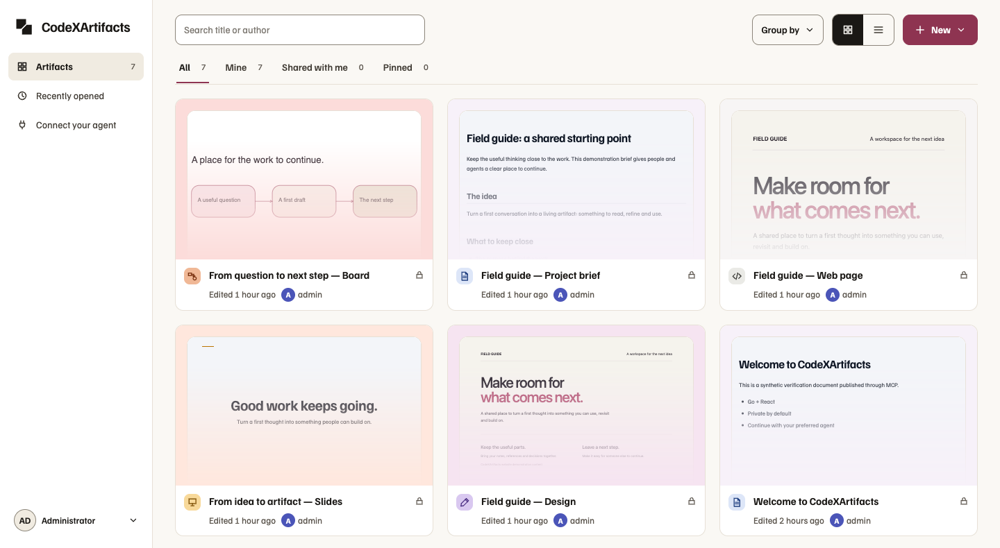
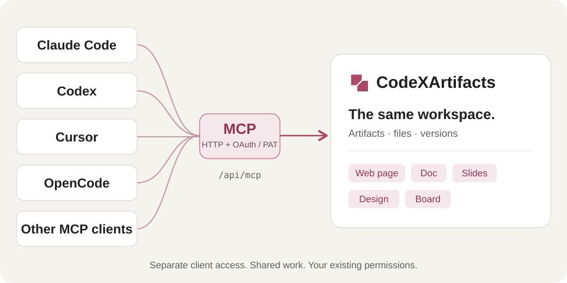

# CodeXArtifacts

A self-hosted workspace for artifacts you and your AI agents can keep building on.

Connect an agent, create something useful, then return to it in the browser.
Keep web pages, documents, slides, designs and boards together—with sharing and version history.

[Website](https://code-x-artifacts.ilogan.app/) · [Quick start](#quick-start) · [Connect your agent](#connect-your-agent) · [Documentation](docs/README.md)



*Actual application screenshot with demonstration content.*

## Formats

| Type in the app | What you can make |
|---|---|
| **Web page** | HTML and React pages, interactive tools |
| **Doc** | Notes, project briefs and documents |
| **Slides** | Presentations with editable slides |
| **Design** | Page layouts with desktop and mobile frames |
| **Board** | Whiteboards, flows and connected ideas |

Docs, Design and Board support live browser collaboration. Artifacts start private;
you choose who can view or edit them. See [format details and exports](docs/artifact-types.md).

## Quick start

Install **Go 1.27.1, Git and Make**, then run:

```sh
git clone https://github.com/iml885203/code-x-artifacts.git
cd code-x-artifacts
make build
./bin/codexartifacts init
./bin/codexartifacts
```

The build downloads its pinned Node.js locally; you do not need to install Node separately.

Open **http://localhost:8080**. Sign in as **admin** using the password in
`.local/admin-password`. Save the password, then delete that plaintext file.
Keep the rest of `.local/` private—it holds your accounts, database and files.
Use `localhost` rather than its IP address for local sign-in.

Prefer containers? Follow the [Docker Compose instructions](docs/deployment.md#docker).

## Connect your agent



Connect multiple agents to the same artifacts. With [OAuth enabled](docs/mcp-oauth.md),
add the MCP URL to your client, sign in and approve access in your browser.
Each client has its own authorization, which you can revoke independently.

1. Open **Connect your agent** in the app and copy the MCP URL into your client.
2. Complete browser authorization. For clients without OAuth, use a separate personal token.
3. Ask the first agent to create an artifact:

   > Publish a one-page project overview to CodeXArtifacts.

4. Continue from a different connected agent:

   > Open the project overview in CodeXArtifacts and add a next-steps section.

Both agents work in the same workspace; you can inspect the result in the browser.
Each client connects independently with the authorizing account's artifact permissions.

<details>
<summary>Manual connection settings</summary>

| Setting | Value for the local quick start |
|---|---|
| Server URL | `http://localhost:8080/api/mcp` |
| Transport | Streamable HTTP |
| Authentication | `Authorization: Bearer <YOUR_TOKEN>` |

For a remote workspace, use its HTTPS address instead of `localhost`.
Use your client's remote MCP configuration format; the app provides ready-to-copy
settings for Claude Code and Codex, plus a generic JSON example for other clients.
OAuth-capable clients can use the URL without a manually copied token when the
operator has enabled OAuth. See [OAuth setup and compatibility](docs/mcp-oauth.md).

</details>

## Limitations

- **Early release.** No external security review or production-readiness claim.
- **One server instance.** Go + React, SQLite and local files; multiple replicas are unsupported.
- **Operator-managed accounts.** No self-registration or email password reset; LDAP is optional.
- **Remote hosting needs HTTPS.** Public links are off by default. See [deployment and backups](docs/deployment.md).
- **Format-specific limits apply.** React uses a bundled runtime; DOCX export is experimental.
  Slides have a different editing model from Docs, Design and Board. See [artifact contracts](docs/artifact-types.md).

## Development

See the [development guide](docs/development.md) for builds, checks, browser tests and the website preview.

## License

[MIT](LICENSE). Based on owner-authorized Pictor source.
Third-party code and fonts keep their own licenses: [third-party notices](THIRD_PARTY_NOTICES.md).
