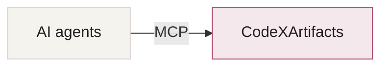

# CodeXArtifacts

A self-hosted workspace for artifacts you and your AI agents can keep building on.

Connect an agent, create something useful, then return to it in the browser.
Keep web pages, documents, slides, designs and boards together—with sharing and version history.

[Website](https://code-x-artifacts.ilogan.app/) · [Quick start](#quick-start) · [Connect your agent](#connect-your-agent) · [Documentation](docs/README.md)


*Actual application screenshot with demonstration content.*

## Formats

| Type in the app | What you can make |
|---|---|
| **Web page** | HTML and React pages, interactive tools |
| **Doc** | Notes, project briefs and documents |
| **Slides** | Presentations with editable slides |
| **Design** | Page layouts with desktop and mobile frames |
| **Board** | Whiteboards, flows and connected ideas |

Docs, Design and Board support live browser collaboration. Artifacts start private;
you choose who can view or edit them. See [format details and exports](docs/artifact-types.md).

## Quick start

Install **Go 1.27.1, Git and Make**, then run:

```sh
git clone https://github.com/iml885203/code-x-artifacts.git
cd code-x-artifacts
make build
./bin/codexartifacts init
./bin/codexartifacts
```

The build downloads its pinned Node.js locally; you do not need to install Node separately.

Open **http://localhost:8080**. Sign in as **admin** using the password in
`.local/admin-password`. Save the password, then delete that plaintext file.
Keep the rest of `.local/` private—it holds your accounts, database and files.
Use `localhost` rather than its IP address for local sign-in.

Prefer containers? Follow the [Docker Compose instructions](docs/deployment.md#docker).

## Connect your agent



Claude Code, Codex, Cursor, OpenCode and other compatible MCP clients can use the same workspace.

1. Open **Connect your agent** in the app.
2. Create a personal token and copy the connection settings for your client.
3. Add the MCP server in that client, then ask:

   > Publish a one-page project overview to CodeXArtifacts.

You can connect multiple clients to the same workspace. Tokens use your existing
artifact permissions and can be revoked individually. Clients need Streamable HTTP
and Bearer-token support; browser OAuth is not supported.

## Limitations

- **Early release.** No external security review or production-readiness claim.
- **One server instance.** Go + React, SQLite and local files; multiple replicas are unsupported.
- **Operator-managed accounts.** No self-registration or email password reset; LDAP is optional.
- **Remote hosting needs HTTPS.** Public links are off by default. See [deployment and backups](docs/deployment.md).
- **Format-specific limits apply.** React uses a bundled runtime; DOCX export is experimental.
  Slides have a different editing model from Docs, Design and Board. See [artifact contracts](docs/artifact-types.md).

## Development

See the [development guide](docs/development.md) for builds, checks, browser tests and the website preview.

## License

[MIT](LICENSE). Based on owner-authorized Pictor source.
Third-party code and fonts keep their own licenses: [third-party notices](THIRD_PARTY_NOTICES.md).
