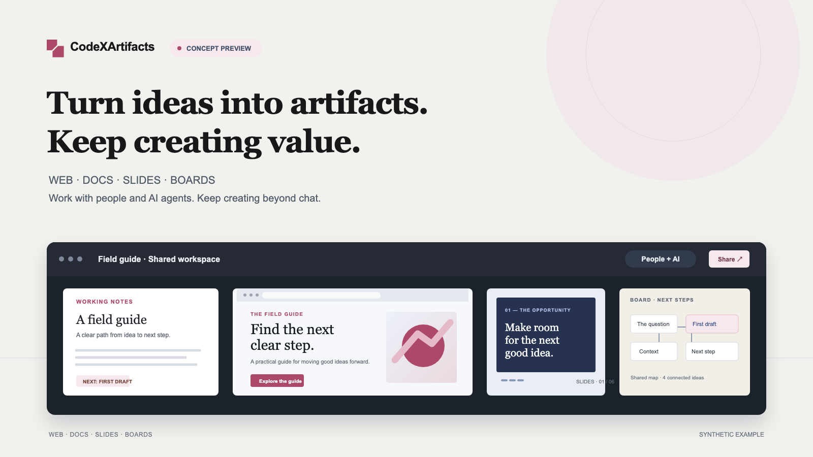

# CodeXArtifacts



[Website](https://iml885203.github.io/code-x-artifacts/) · [Quick start](#quick-start) · [Connect your agent](#connect-your-agent)

A self-hosted home for work you and your AI agents can keep building on.
Create web pages, documents, designs, boards and slides; give them stable links,
share them deliberately, and continue editing beyond the conversation.

- **Create with your preferred agent.** Connect Claude Code, Codex or another MCP client.
- **Continue together.** Edit Docs, Design and Board in the browser, with shared live rooms.
- **Keep control.** Private by default, explicit sharing, version history and local storage.

Go + React. SQLite. One server. No Cloudflare account or company directory required.
Early open-source release; see the [limitations](#limitations) before deploying.

## Quick start

Requires Go 1.27.1, Git and Make. The build installs its pinned Node 24.22.0 locally,
verifies the download checksum, and installs locked npm dependencies.

```sh
git clone https://github.com/iml885203/code-x-artifacts.git
cd code-x-artifacts
make build
./bin/codexartifacts init
./bin/codexartifacts
```

Open **http://localhost:8080**, sign in as `admin`, and read the generated password
from `.local/admin-password`. Save it in a password manager, then delete that
plaintext file. `.local/users.json` contains only the bcrypt hash; keep it private.
The initializer never overwrites existing files.

Data persists under `.local/`: SQLite and artifact assets. Use `localhost`, not
its IP address: browser sessions use Secure cookies and rely on the localhost exception.

### Docker Compose

```sh
docker compose build
docker compose run --rm app init /data
docker compose run --rm password cat /data/admin-password
docker compose up -d
```

The second one-off helper reads the password from the same named volume. Save it
securely, then remove the plaintext password file with the helper described in
[deployment](docs/deployment.md). The application runs as a non-root user;
port 8080 binds to loopback and the `data` volume persists accounts, SQLite and assets.

## Connect your agent

Sign in and open **Account → Connect your agent**. Create an individually revocable
personal token, choose your client, and copy the generated connection details.
MCP uses streamable HTTP at `/api/mcp`; it requires `Authorization: Bearer <token>`.
The server name and `PICTOR_TOKEN` environment variable remain compatible with Pictor.
No plugin is required. Tokens grant the same artifact permissions as their owner.

Ask your agent: “Publish a one-page project overview to CodeXArtifacts.” Have it read
the server's `kinds` guide for the format before publishing. Browser OAuth is not supported.

## Formats

| Format | Create and continue | Export |
|---|---|---|
| Web | HTML or React/TSX, optional versioned files and shared-data bridge | HTML for single-file HTML; browser print |
| Docs | Markdown publishing, browser block editor and live collaboration | Markdown, experimental DOCX, browser print |
| Design | HTML frames, visual canvas, live editing and agent operations | ZIP, browser print |
| Board | Excalidraw canvas, live collaboration and image assets | SVG, browser PNG |
| Slides | Structured slides, playback and focused slide editing | Browser print |

The actual formats, validation and limitations are described in the
[artifact contracts](docs/artifact-types.md). A rendered React artifact is not an
arbitrary npm project: its imports use a pinned, embedded runtime.

## Sharing and storage

Artifacts start private. Authors can invite named editors or share with signed-in
workspace members. Public links are disabled unless the operator explicitly sets
`PICTOR_PUBLIC_LINKS=true`. HTML and React execute in an opaque-origin sandbox;
HTTP and MCP share authorization checks.

SQLite stores metadata, versions and accepted room updates; files live beside it.
Quiet rooms become version snapshots after two minutes. Run **one replica**.
Back up the entire data directory while the server is stopped; do not copy only the
SQLite main file while WAL writes are active. See [deployment](docs/deployment.md).

## Development

```sh
make hooks
GO_TEST_FLAGS=-p=2 VERIFY_BUDGET=240 make verify
make web-dev    # optional Vite hot reload in front of the running Go server
```

The explicit budget accommodates first-run tool installation and race compilation;
Go package concurrency is bounded for a shared development host, and
individual test-unit limits stay enabled. `make verify` runs formatting, lint, contracts, frontend and Go tests and build checks.
Browser tests are separate: `make e2e-browser`, then `make e2e`.
The [website](website/) is static HTML/CSS: preview with
`python3 -m http.server 4176 --bind 127.0.0.1 --directory website`.

## Limitations

- Early release; production hardening and external security review are not claimed.
- Local accounts are operator-managed in a private JSON file. Optional LDAP needs
  your own explicit settings. There is no self-registration, reset-email or browser OAuth.
- Use HTTPS and login rate limits at a trusted reverse proxy for remote access.
- Live room coordination requires one running server. Multi-replica operation is unsupported.
- DOCX layout has not been qualified in native Microsoft Word. Slides do not use the
  same collaborative room model as Docs, Design and Board.
- The website previews are labelled synthetic illustrations, not application screenshots.
- A TypeScript backend and Cloudflare-native deployment are deferred.

## License and attribution

[MIT](LICENSE). This independent release is based on owner-authorized Pictor source,
with a clean public history. Third-party code and fonts retain their own licenses;
see [THIRD_PARTY_NOTICES.md](THIRD_PARTY_NOTICES.md) and the embedded runtime notices.
